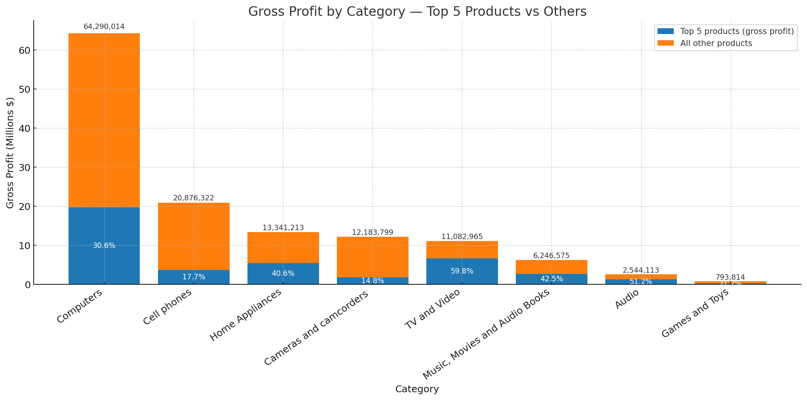
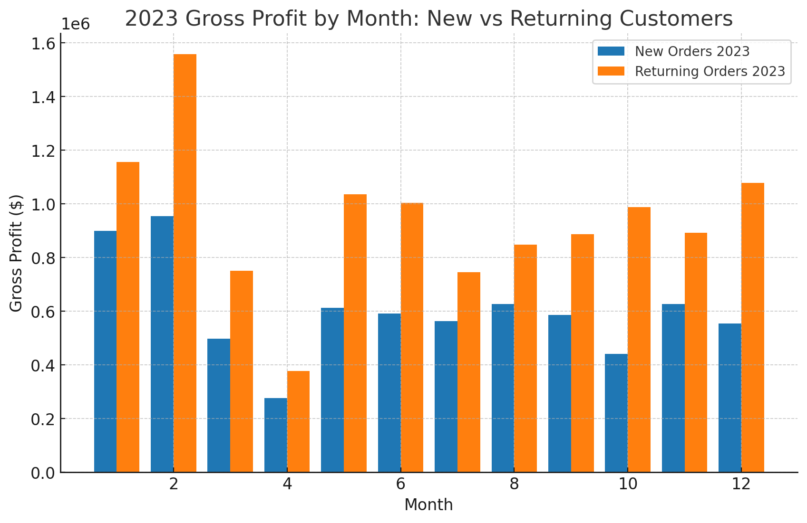
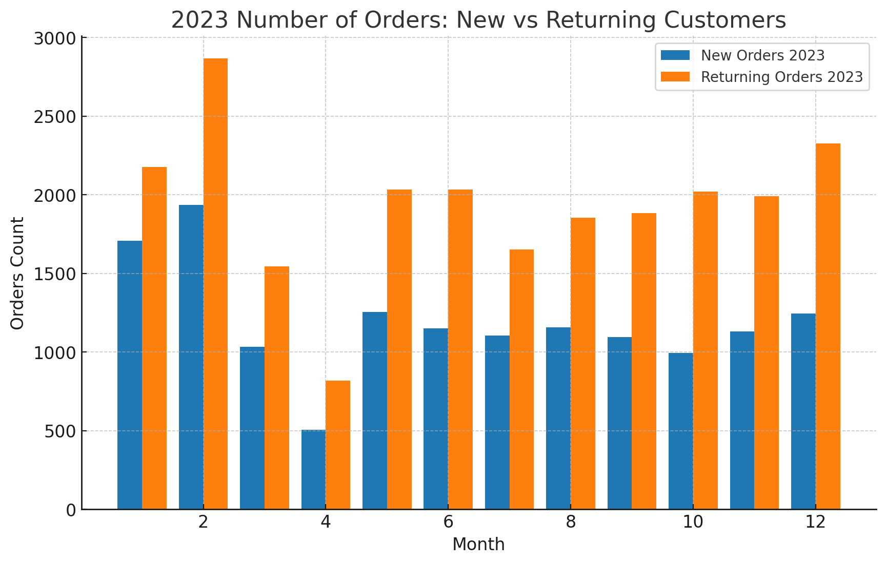
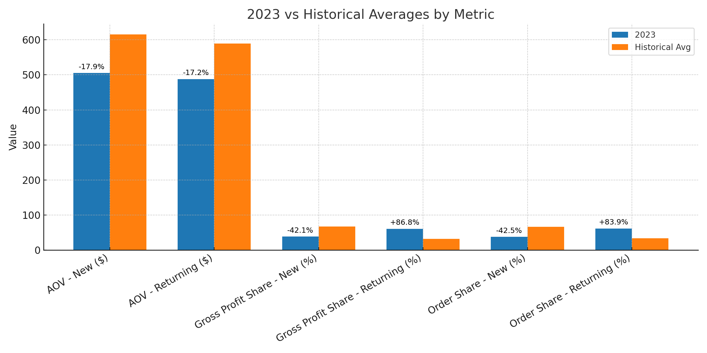
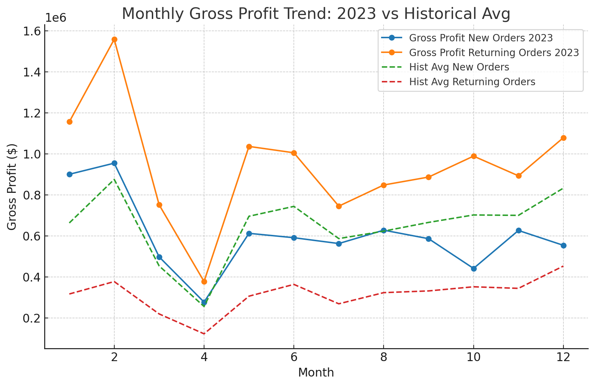
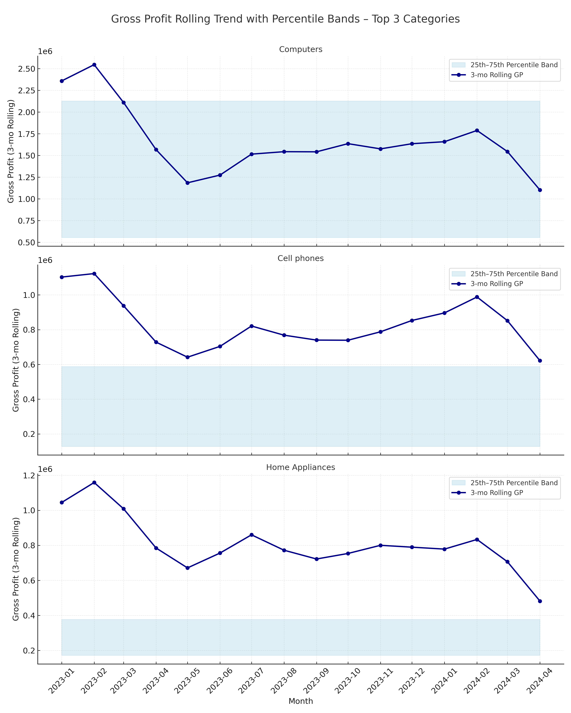

# Sales & Customer Profitability Analysis

## Overview
This project analyzes customer behavior, retention dynamics, and profitability drivers for an e-commerce business. It moves beyond top-line revenue to focus on **gross profit**, concentration risk, and momentum vs historical baselines.

## Business Questions
1. **Category Profitability (Gross Profit):** Which categories and products deliver the highest contribution to gross profit?
2. **New vs Returning Customers – 2023 vs Historical Baseline:** How has the balance between new and returning customers shifted?
3. **Momentum & Percentile Bands:** Are key categories currently under/over-performing relative to their historical norms?

---

## 1) Category Profitability (Gross Profit)

**Goal**  
Identify which categories and products deliver the highest contribution to **gross profit**, not just revenue.

**How we calculate it**  
- **Gross profit per transaction** = `(netprice – cost) × quantity × exchangerate`  
- **Product standardization**: consolidated color/spec variants into **parent products**  
- Aggregated to **parent product** and **category**; ranked and benchmarked

**Metrics produced**  
- Product share of category  
- Category share of company total  
- Ranks: product within category and category overall

**🖥️ Query**: [`Scripts/1_product_analysis.sql`](Scripts/1_product_analysis.sql)

**📈 Visualization**  
_Gross Profit by Category (Top-5 products vs long tail)_

**How to read**  
- Each bar = category gross profit (Y-axis in **millions $**)  
- Dark segment = Top-5 products’ share (labeled %)  
- Light segment = remaining products (“long tail”)  
- Values above bars = absolute category gross profit

**Key Findings**  
- Profitability is concentrated; **Computers** and **Cameras** lead overall GP contribution.  
- Within categories, **Top-5 products drive ~30–60%** of category profit—dependency risk.  
- **Audio** and **Games & Toys** show higher concentration; **Cell Phones** is more distributed.

**Recommended Actions**  
- Prioritize investment in hero categories (**Computers, Cameras**) via marketing, inventory depth, and supplier negotiations.  
- Reduce concentration risk in **Audio/Games & Toys** by diversifying or developing substitutes.  
- Optimize the long tail: retire/reprice underperformers; test bundles/dynamic pricing.  
- Propagate winning playbooks from top SKUs to mid-tier products.

---

## 2) New vs Returning Customers – 2023 vs Historical Baseline

**Goal**  
Understand whether growth is driven by **acquisition** (new customers) or **retention** (returning customers), and how 2023 compares to historical norms (2015–2022).

### 2.1 2023: Gross Profit & Customer Volume by Segment

**🖥️ Query**: [`Scripts/2a_2023_customer_analysis.sql`](Scripts/2a_2023_customer_analysis.sql)

**📈 Visualizations**  
- _2023 Gross Profit by Month – New vs Returning_  
  

- _2023 Order Count – New vs Returning_  
  

**Key Findings**  
- **Returning customers** generated more gross profit than new customers in **every month** of 2023.  
- New customer profit was **volatile** (notably weak in **April** and **October**); returning customers formed a **stable baseline**.  
- Order counts mirrored profit: returning orders > new orders across the year.

**Business Insight**  
- Acquisition delivered volume but lacked value density; retention provided resilience.  
- Over-reliance on returning customers introduces **growth ceiling risk** unless acquisition efficiency improves.

---

### 2.2 2023 vs Historical Averages (2015–2022)

**🖥️ Queries**  
- [`Scripts/2b_historical_customer_analysis.sql`](Scripts/2b_historical_customer_analysis.sql)  
- [`Scripts/2c_comparison_customer_analysis.sql`](Scripts/2c_comparison_customer_analysis.sql)

**📈 Visualization**  
- _Annual Comparison – 2023 vs Historical Baseline_  
  

**Key Findings**  
- **AOV** declined in 2023 for both groups (**~–18%** vs history).  
- **Returning customers’ GP share** increased to **~61%**; new customers fell to **~39%**.  
- Returning customers also dominated **order share**.

**Business Insight**  
- Acquisition efficiency weakened; retention strength is masking **top-line fragility**.  
- Engagement depth with existing customers is increasing, but **future expansion** requires stronger acquisition economics.

---

### 2.3 Monthly Trends: 2023 vs Historical Baseline

**📈 Visualization**  
- _Monthly Gross Profit Trends – 2023 vs Historical Averages_  
  

**Key Findings**  
- Returning customers **outperformed** historical levels in most months.  
- New customers consistently **underperformed**, with the gap widening mid-year.  
- Growth mix has shifted toward **retention-driven profitability**.

**Strategic Recommendations**  
- **Reinvest in acquisition quality** (target higher-value segments) to lift AOV and GP.  
- **Deepen retention leverage** (loyalty, personalization, cross-sell) to extend LTV.  
- **Balance the growth portfolio** to avoid over-indexing on retention.  
- **Smooth acquisition volatility** via campaign timing, creative testing, and channel mix.

---

## 3) Momentum & Percentile Bands (Rolling 3-Month GP)

**Goal**  
Benchmark category momentum against history using **rolling 3-month gross profit** and **percentile bands** to flag under/over-performance.

**Methodology**  
- Compute **gp_roll3** per category: `SUM(gp) OVER (PARTITION BY category ORDER BY month ROWS BETWEEN 2 PRECEDING AND CURRENT ROW)`.  
- Derive **historical bands (2015–2022)** via `PERCENTILE_CONT(0.25/0.75)` on `gp_roll3`.  
- Classify **2023+** months as **Low (<25th)**, **Mid (25–75th)**, **High (≥75th)**.

**🖥️ Query**: [`Scripts/3_momentum_band_analysis.sql`](Scripts/3_momentum_band_analysis.sql)

**📈 Visualization**  
_Gross Profit Momentum vs Percentile Bands – Top 3 Categories (Computers, Cell Phones, Home Appliances)_

**Key Findings**  
- **Computers**: Above the historical band in several months → **outperformance** signal.  
- **Cell Phones**: Mostly within band → **stable**, tracking norms.  
- **Home Appliances**: Frequent dips near/below band → **relative weakness** vs history.

**Business Insight**  
- Above-band categories warrant **incremental investment** (promo, availability, supplier terms).  
- Below-band categories need **pricing/assortment refresh** or targeted demand generation.  
- Banding converts raw trends into a **relative risk/opportunity framework**.

---

## Data Model & SQL Design

The analysis treats `sales` as the central transaction table. Product and customer attributes are joined by keys when the analysis needs descriptive business context, keeping transaction-level measures separate from descriptive entities. This mirrors a simple analytical model and makes each calculation traceable back to the underlying sales activity.

- **`sales`** provides transaction-level measures such as quantity, price, exchange rate, and order date.
- **`product_clean`** adds product and category attributes used for profitability and ranking analysis.
- **`customer`** provides customer attributes used to separate new and returning customer behaviour.

## Technical Details
- **Database:** PostgreSQL
- **SQL design:** CTE pipelines break larger analyses into readable stages before final aggregation.
- **Window functions:** `SUM ... OVER`, `RANK`, and `DENSE_RANK` support category totals and relative performance without losing row-level context.
- **Historical benchmarking:** `PERCENTILE_CONT` creates 25th–75th percentile bands for comparing current rolling gross profit with historical norms.
- **Visualization:** Python and Matplotlib turn query outputs into interpretable business charts.

## Repro Steps
1. Run `Scripts/1_product_analysis.sql` and generate `images_all/q1_image.png`.
2. Run `Scripts/2a_2023_customer_analysis.sql` and generate `images_all/q2_2023_gross_new_vs_old.png` and `images_all/q2_2023_order_count.png`.
3. Run `Scripts/2b_historical_customer_analysis.sql` and `Scripts/2c_comparison_customer_analysis.sql` to generate `images_all/q2_2023_vs_historical_average.png` and `images_all/q2_monthly_gross_trend.png`.
4. Run `Scripts/3_momentum_band_analysis.sql` and generate `images_all/q3_gp_rolling_trend.png`.

---
